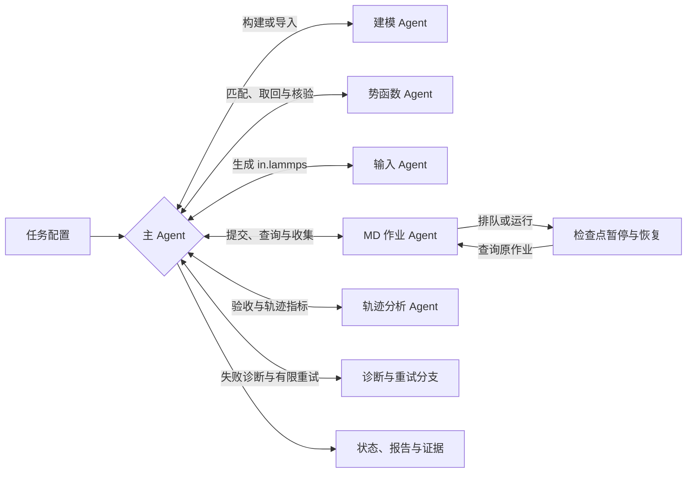

# 设计与参考来源

## 来源与使用范围

1. ChatMat: a multi-agent chemist for autonomous material prediction and exploration. Digital Discovery 2026, 5, 2886–2898. DOI: https://doi.org/10.1039/D5DD00582E 。阅读了用户提供的本地 PDF，重点为方法 2.1、2.3–2.5 与图 1–3：Manager 协调角色、计算设计和受限重试、计算执行与数据存储分离。
2. https://github.com/wkk990914-droid/MD-Simulation-Agent ，本地参考 checkout commit `f79b87de4c858d9f4cb1f040e38d82658ca192c6`。查看了 supervisor、molecular_agent、LAMMPS 输入生成及 ensemble_analysis。该仓库主要面向分子建模/OPLS-AA 示例，不能直接视为 ML 势+HPC 执行系统。未复制其代码，未发现根目录 LICENSE，故不将参考 checkout 作为本项目发行内容。
3. LangGraph 官方状态与持久化：https://docs.langchain.com/oss/python/langgraph/persistence 。使用 SQLite checkpointer、interrupt/Command 恢复和显式条件边。
4. LAMMPS PACE：https://docs.lammps.org/pair_pace.html 。要求用户明确提供模型与元素映射。DeePMD 需要远端 LAMMPS 有兼容插件。
5. Vriza et al., Multi-agentic AI framework for end-to-end atomistic simulations. Digital Discovery 2026, 5, 440–452. https://doi.org/10.1039/D5DD00435G 。项目采用论文中管理员协调建模、势函数、输入、HPC 与分析角色的思路，并用 LangGraph 状态分支实现调度。

论文中的模型分歧路由涉及训练/DFT，首版仅预留扩展位置；没有把文中某个经验阈值当作跨体系通用验收准则，也未宣称复现 ChatMat 全部功能。

## 角色到图节点

每个专职角色完成后将结果写回共享状态。主 Agent 依次派发建模、选势、生成输入、提交、监控、回收结果和分析，并根据校验结果派发报告或诊断。MD 作业角色有三个节点，分别负责提交、查询与收集。选择 `prepare` 时使用同一张图，在提交节点前暂停。

运行记录中的 `schema: 2` 对应这张图。较早的 `schema: 1` 运行目录沿原节点图恢复，以兼容已有的 SQLite 检查点。选势 Agent 依据目录条目的声明做兼容性筛选。校验由程序处理，模型可以审阅配置和解释证据。

## 恢复语义

LangGraph checkpoint 和作业调度器不处于同一数据库事务。为了处理“作业已提交但节点状态尚未保存”的窗口：

- 本地执行先创建 exclusive 提交标记，作业启动后原子写回执；回执缺失但提交标记存在，拒绝盲目重复启动。
- 远程用原子 mkdir 获得提交权，将调度器回执写入 `.job_id`；恢复时先读取远程回执。
- 断网导致无法确认提交结果时停止；绝不将网络超时解释为“未提交”。
- 每次重试使用独立 attempt 文件夹，保留旧输出、相同的输入文件与模型哈希。

此设计选择在不确定时保留人工恢复入口，不能宣称跨 SQLite/SSH/调度器达成 exactly-once 分布式事务。
